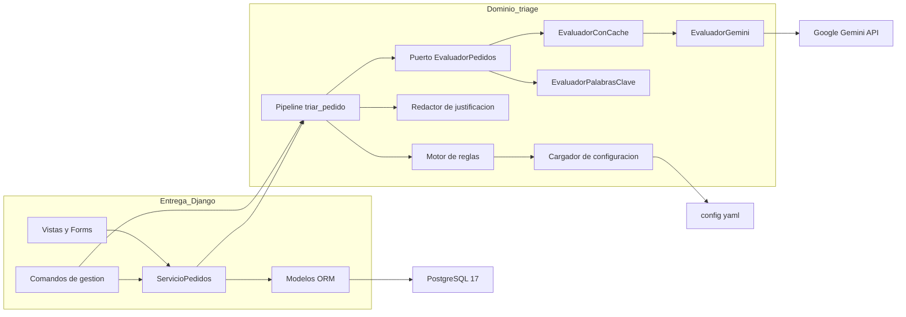
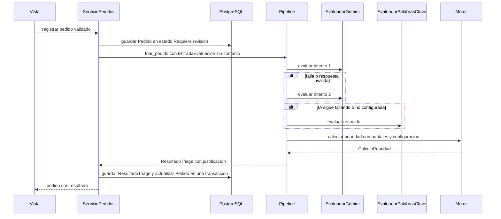
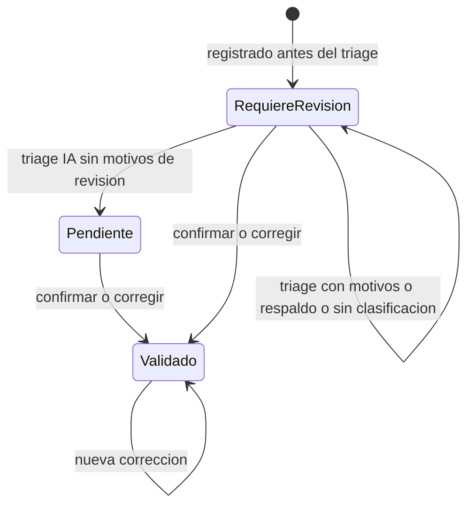
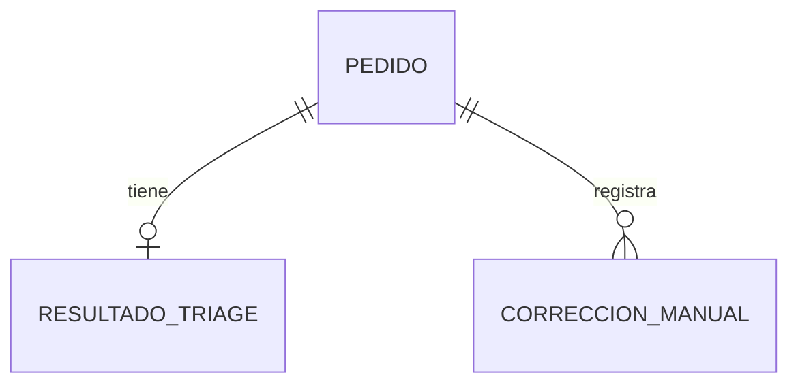

# Documento de Diseño Técnico — Triage de Pedidos de Mantenimiento

## Overview

**Propósito**: el Sistema de Triage permite que el responsable de mantenimiento reciba los pedidos de las dependencias universitarias ya interpretados y con una prioridad P1–P4 reproducible y justificada. Así deja de depender de quién redacta el pedido y de cómo lo hace.

**Usuarios**:
- El **solicitante** carga pedidos con un formulario.
- El **triador** pega textos de correos o notas, trabaja sobre una bandeja ordenada, revisa el detalle de cada pedido y confirma o corrige la prioridad y el tipo.
- El **equipo de la hackatón** carga y evalúa un dataset etiquetado para la demo.

**Impacto**: es un proyecto greenfield. Introduce el paquete de dominio `triage/` (sin Django), la app Django `pedidos/`, la configuración `config/*.yaml`, el dataset `data/` y la infraestructura Docker Compose (`web` y `db`).

### Goals
- Interpretar cada pedido con Gemini y obtener datos estructurados y validados: tipo, ubicación, puntaje 0–3 por criterio, evidencia y confianza.
- Calcular la prioridad de forma determinística con pesos, umbrales y reglas de escalamiento configurables.
- Funcionar sin IA mediante el respaldo por palabras clave, sin perder ningún pedido.
- Ofrecer una bandeja, un detalle y correcciones con trazabilidad completa.
- Completar el triage en menos de 10 s por pedido, medir los aciertos contra el dataset y levantar todo con un único comando.

### Non-Goals
- Autenticación, roles o permisos. El "responsable" de una corrección es un nombre ingresado en el formulario.
- Lectura del correo institucional, notificaciones, adjuntos y fotos.
- Asignación de cuadrillas y órdenes de trabajo.
- Procesamiento asíncrono (colas o workers).
- Edición de la configuración desde la UI. La configuración se edita en YAML y se aplica reiniciando.
- Re-priorizar pedidos existentes cuando cambia la configuración (requisito 10.4).

## Architecture

### Architecture Pattern & Boundary Map



**Integración de la arquitectura**:
- **Patrón seleccionado**: hexagonal liviana. El dominio `triage/` define el puerto `EvaluadorPedidos`. Gemini, el respaldo por palabras clave y el caché son adaptadores, y Django es el adaptador de entrega y persistencia. La comparación de alternativas está en `research.md`.
- **Fronteras**:
  - `triage/` es dueño de la interpretación, el cálculo y la justificación, y no importa `django`.
  - `pedidos/` es dueño de la entrada de usuario, la persistencia, el estado del pedido y las correcciones.
  - `config/` es dueño de la política institucional.
- **Patrones del steering que se preservan**:
  - "La IA evalúa, la regla decide".
  - Funciones puras en el motor.
  - Vistas delgadas con `pedidos/services.py`.
  - Bordes validados con Pydantic y Django Forms.
  - Un único punto de acceso a la IA.
- **Componentes nuevos y su razón**:
  - El **pipeline** concentra la política de reintento y respaldo, que es regla de negocio (requisitos 6.3 y 6.4).
  - El **caché** permite una demo sin red (requisito 11.4).
  - El **redactor** separa la justificación del motor para mantener una responsabilidad por componente.

### Technology Stack

| Capa | Elección / Versión | Rol en la feature | Notas |
|---|---|---|---|
| Frontend | Templates de Django + Pico.css (CDN) | Formulario, pegado de texto, bandeja, detalle y corrección | Sin SPA ni build. Textos en español |
| Backend | Python 3.12, Django 5.2 LTS | Vistas, forms, ORM, admin y comandos | `pedidos/services.py` orquesta la persistencia |
| Dominio | `pydantic` v2, `pyyaml` | Schemas, validación de configuración y respuesta de la IA | Sin dependencias de Django |
| IA | Gemini REST `v1beta/models/{modelo}:generateContent` vía `google-genai` ≥ 1.55 (`models.generate_content`) | Interpretación estructurada | API key en el header `X-goog-api-key`, temperatura 0, salida JSON con schema, timeout de 4 s y sin reintentos del SDK |
| Datos | PostgreSQL 17 + `psycopg[binary]` 3 | Pedidos, resultados y correcciones | `JSONField` para la evaluación completa |
| Infraestructura | Docker Compose v2 (`web`, `db`), `uv` | Arranque con `docker compose up --build` | `web` migra y luego ejecuta `runserver` |
| Calidad | `pytest`, `pytest-django`, `ruff` | Tests puros y de integración | Gemini se simula en los tests |

## System Flows

### Flujo de triage de un pedido



**Decisiones del flujo**:
- El `Pedido` se guarda **antes** de evaluarlo. Cualquier excepción posterior deja el pedido registrado como "Requiere revisión" con el motivo `sin_clasificacion` (requisito 6.5).
- Cuando falta `GEMINI_API_KEY` (`ErrorEvaluacion.NO_CONFIGURADO`), el pipeline pasa directo al respaldo sin reintentar. Cualquier otro fallo (timeout, 4xx/5xx, 429 o respuesta inválida) consume exactamente un reintento.
- Si el respaldo no detecta ningún tipo, el resultado sale con `origen = sin_clasificacion` y sin prioridad.

### Estados del pedido



**Motivos de revisión** (`MotivoRevision`): `confianza_baja` (6.1), `texto_insuficiente` y `conflicto_tipos` (6.2), `dependencia_no_informada` y `ubicacion_no_informada` (2.4), `clasificacion_respaldo` (6.4) y `sin_clasificacion` (6.5). El estado es "Pendiente" solo si la lista de motivos queda vacía.

Un pedido "sin clasificación" no tiene prioridad que confirmar, así que solo se puede **corregir**. La corrección exige prioridad y tipo.

## Requirements Traceability

| Requisito | Resumen | Componentes | Interfaces | Flujos |
|---|---|---|---|---|
| 1.1, 1.3 | Formulario y validación de campos | `FormularioPedido`, `VistasPedidos` | `GET/POST /pedidos/nuevo/` | — |
| 1.2, 1.4 | Registro con canal "formulario" y triage automático | `ServicioPedidos`, `Pipeline` | `ServicioPedidos.registrar` | Triage |
| 1.5 | Mostrar el resultado al finalizar | `VistasPedidos` | Redirección a `pedidos:detalle` | Triage |
| 2.1, 2.5 | Pegado de texto libre y rechazo de vacíos | `FormularioTextoLibre` | `GET/POST /pedidos/texto/` | — |
| 2.2 | Registro con el texto íntegro y canal "texto libre" | `ServicioPedidos` | `registrar` | Triage |
| 2.3, 2.4 | Extracción de dependencia y ubicación; "no informado" | `EvaluadorGemini`, `Pipeline` | `RespuestaGemini`, `MotivoRevision` | Triage, Estados |
| 3.1, 3.2, 3.4 | Descripción, ubicación, tipos, puntajes y confianza | `EvaluadorGemini`, `EvaluacionCriterios` | `EvaluadorPedidos.evaluar` | Triage |
| 3.3, 3.5 | Evidencia para puntajes ≥ 2; descartar resultados inválidos | `ValidadorEvaluacion` | `validar_evaluacion` | Triage |
| 3.6 | Texto original inmutable | `Pedido.texto_original` | — | — |
| 3.7 | Menos de 10 s | `EvaluadorGemini` (timeout), `Pipeline` | `duracion_ms` | Triage |
| 3.8 | Gemini con modelo configurable | `EvaluadorGemini` | `GEMINI_MODEL` | — |
| 4.1–4.8 | Puntaje, umbrales y escalamiento determinísticos | `MotorReglas`, `ConfiguracionTriage` | `calcular_prioridad` | Triage |
| 5.1–5.5 | Justificación en español | `RedactorJustificacion` | `redactar_justificacion` | Triage |
| 6.1, 6.2 | Revisión por confianza, texto insuficiente o conflicto | `Pipeline` | `MotivoRevision` | Estados |
| 6.3, 6.4 | Reintento único y respaldo | `Pipeline`, `EvaluadorPalabrasClave` | `triar_pedido` | Triage |
| 6.5 | Registrar el pedido aunque todo falle | `ServicioPedidos` | Persistencia previa al triage | Triage, Estados |
| 6.6 | Origen IA o respaldo | `ResultadoTriage.origen` | `OrigenResultado` | — |
| 7.1–7.6 | Bandeja ordenada y filtrable | `ConsultaBandeja`, `VistasPedidos` | `GET /pedidos/` | — |
| 8.1–8.3 | Detalle, recomendación original e historial | `VistasPedidos` | `GET /pedidos/<id>/` | — |
| 9.1–9.6 | Confirmar y corregir con trazabilidad | `ServicioPedidos`, `FormularioCorreccion`, `CorreccionManual` | `confirmar`, `corregir` | Estados |
| 10.1–10.4 | Configuración externa validada | `ConfiguracionTriage`, `PedidosConfig.ready` | `cargar_configuracion` | — |
| 11.1, 11.2 | Dataset y carga de ejemplos | `data/pedidos_ejemplo.json`, comando `cargar_ejemplos` | Contrato de batch | — |
| 11.3, 11.4 | Evaluación de aciertos y reutilización del caché | Comando `evaluar_dataset`, `EvaluadorConCache` | Contrato de batch | — |
| 12.1 | Sin datos de contacto hacia la IA | `EntradaEvaluacion`, `anonimizar_texto` | — | Triage |
| 12.2 | Secretos fuera del repositorio | `sitio/settings.py`, `.env.example` | Variables de entorno | — |
| 12.3 | Un único comando | `docker-compose.yml`, `Dockerfile`, README | `docker compose up --build` | — |
| 12.4 | UI en español | Templates, mensajes de los forms | `LANGUAGE_CODE = "es"` | — |
| 12.5 | Persistencia entre reinicios | Volumen `pgdata` | — | — |

## Components and Interfaces

| Componente | Capa | Intención | Requisitos | Dependencias clave | Contratos |
|---|---|---|---|---|---|
| `ConfiguracionTriage` | Dominio | Cargar y validar la política desde YAML | 10.1–10.3, 4.7 | pyyaml, pydantic (P0) | Service |
| Schemas de dominio | Dominio | Tipos compartidos entre componentes | 3.x, 4.x, 6.6 | pydantic (P0) | State |
| `MotorReglas` | Dominio | Calcular puntaje y prioridad | 4.1–4.8 | `ConfiguracionTriage` (P0) | Service |
| `RedactorJustificacion` | Dominio | Redactar la justificación en español | 5.1–5.5 | `CalculoPrioridad` (P0) | Service |
| `ValidadorEvaluacion` | Dominio | Verificar rangos, tipos y evidencia | 3.1–3.5 | `ConfiguracionTriage` (P0) | Service |
| `EvaluadorGemini` | Dominio / adaptador | Interpretar el pedido con Gemini | 2.3, 3.1–3.4, 3.7, 3.8, 12.1 | google-genai (P0) | Service |
| `EvaluadorPalabrasClave` | Dominio / adaptador | Clasificar sin IA | 6.4 | `ConfiguracionTriage` (P0) | Service |
| `EvaluadorConCache` | Dominio / adaptador | Reutilizar evaluaciones almacenadas | 11.4 | Archivo JSON (P1) | Service |
| `Pipeline` (`triar_pedido`) | Dominio | Orquestar evaluación, reintento, respaldo, motor y justificación | 3.5, 3.7, 6.1–6.6 | Evaluadores (P0), `MotorReglas` (P0) | Service |
| `ServicioPedidos` | Entrega | Registrar, persistir, confirmar y corregir | 1.2, 1.4, 2.2, 6.5, 9.x | Pipeline (P0), ORM (P0) | Service |
| Modelos ORM | Persistencia | `Pedido`, `ResultadoTriage`, `CorreccionManual` | 3.6, 8.3, 9.4, 9.5, 10.4, 12.5 | PostgreSQL (P0) | State |
| `ConsultaBandeja` | Entrega | Filtrar y ordenar la bandeja | 7.1–7.3, 7.6 | ORM (P0) | Service |
| `VistasPedidos` + Forms | Entrega / UI | Pantallas y validación de entrada | 1.1, 1.3, 1.5, 2.1, 2.5, 7.x, 8.x, 9.1–9.3, 12.4 | `ServicioPedidos` (P0) | API |
| Comandos de gestión | Entrega / batch | Cargar y evaluar el dataset; validar la configuración | 10.3, 11.1–11.4 | Pipeline, `ServicioPedidos` (P0) | Batch |
| Infraestructura | Runtime | Compose, Dockerfile y settings | 12.2, 12.3, 12.5 | Docker (P0) | — |

### Dominio (`triage/`)

#### Schemas de dominio (`triage/schemas.py`)

| Campo | Detalle |
|---|---|
| Intención | Contratos tipados compartidos por todos los componentes del dominio |
| Requisitos | 3.1, 3.2, 3.4, 4.1, 5.1, 6.6 |

**Contratos**: State [x]

```python
class Prioridad(IntEnum):            # el orden natural coincide con la urgencia (1 es la más urgente)
    P1 = 1; P2 = 2; P3 = 3; P4 = 4

class OrigenResultado(StrEnum):
    IA = "ia"; RESPALDO = "respaldo"; SIN_CLASIFICACION = "sin_clasificacion"

class MotivoRevision(StrEnum):
    CONFIANZA_BAJA = "confianza_baja"; TEXTO_INSUFICIENTE = "texto_insuficiente"
    CONFLICTO_TIPOS = "conflicto_tipos"; DEPENDENCIA_NO_INFORMADA = "dependencia_no_informada"
    UBICACION_NO_INFORMADA = "ubicacion_no_informada"
    CLASIFICACION_RESPALDO = "clasificacion_respaldo"; SIN_CLASIFICACION = "sin_clasificacion"

class Canal(StrEnum):
    FORMULARIO = "formulario"; TEXTO_LIBRE = "texto_libre"

class EntradaEvaluacion(BaseModel):          # lo único que sale hacia la IA (12.1): no tiene campo de contacto
    texto: str                               # ya anonimizado
    canal: Canal
    dependencia_informada: str | None
    ubicacion_informada: str | None

class PuntajeCriterio(BaseModel):
    puntaje: Annotated[int, Field(ge=0, le=3)]
    evidencia: list[str]                     # fragmentos literales del texto (≤ 3)

class EvaluacionCriterios(BaseModel):        # salida normalizada de cualquier evaluador
    descripcion_normalizada: str
    dependencia: str | None
    ubicacion: str | None
    tipo_principal: str
    tipos_secundarios: list[str]
    criterios: dict[str, PuntajeCriterio]    # claves = criterios configurados, todos presentes
    confianza: Annotated[float, Field(ge=0.0, le=1.0)]
    texto_insuficiente: bool
    conflicto_tipos: bool

class ReglaAplicada(BaseModel):
    id: str; descripcion: str; prioridad_minima: Prioridad

class CalculoPrioridad(BaseModel):
    suma_ponderada_x3: int                   # Σ peso × puntaje, entre 0 y 300
    puntaje_total: Decimal                   # suma_ponderada_x3 / 3, con 2 decimales
    prioridad_umbral: Prioridad
    prioridad_final: Prioridad
    reglas_aplicadas: list[ReglaAplicada]

class CriterioJustificado(BaseModel):
    clave: str; nombre: str; puntaje: int; evidencia: list[str]

class Justificacion(BaseModel):
    texto: str                               # párrafo en español para personas no técnicas
    criterios_destacados: list[CriterioJustificado]   # criterios con puntaje ≥ 2
    es_respaldo: bool

class ResultadoTriage(BaseModel):
    origen: OrigenResultado
    modelo: str | None                       # modelo de Gemini, o None si el resultado es de respaldo
    evaluacion: EvaluacionCriterios | None   # None si el origen es sin_clasificacion
    calculo: CalculoPrioridad | None
    justificacion: Justificacion
    motivos_revision: list[MotivoRevision]
    intentos_ia: int                         # 0, 1 o 2
    errores: list[str]                       # descripción técnica de cada fallo (no se muestra al solicitante)
    version_config: str                      # sha256 corto de los YAML
    duracion_ms: int
```

- **Invariantes**:
  - `origen = SIN_CLASIFICACION` ⇔ `evaluacion is None` ⇔ `calculo is None`.
  - Si `origen = RESPALDO`, la lista de motivos incluye `CLASIFICACION_RESPALDO`.
  - `prioridad_final ≤ prioridad_umbral`, en el orden de urgencia (requisito 4.6).

#### ConfiguracionTriage (`triage/config.py`, `config/criterios.yaml`, `config/tipos.yaml`)

| Campo | Detalle |
|---|---|
| Intención | Cargar, validar y exponer la política institucional como un objeto inmutable |
| Requisitos | 10.1, 10.2, 10.3, 4.7 |

**Responsabilidades y restricciones**
- Cargar el contenido descrito en el modelo de datos de configuración (ver *Data Models*): criterios, umbrales, reglas, confianza mínima, tipos con señales y `senales_respaldo` por criterio.
- Rechazar con `ConfiguracionInvalida`, con un mensaje que enumere todos los errores, cuando:
  - una regla o una señal referencia un criterio desconocido;
  - hay pesos negativos, pesos no enteros o pesos que no suman 100;
  - un criterio `informativo` tiene peso distinto de 0 o aparece en una regla (requisito 4.7);
  - los umbrales no son estrictamente decrecientes de P1 a P3;
  - una regla tiene un valor fuera de 0–3;
  - la confianza mínima está fuera de 0–1;
  - la lista de tipos está vacía o tiene duplicados.
- Calcular `version` como el sha256 de los archivos, que se guarda en cada resultado (requisito 10.4).

**Contratos**: Service [x]

```python
class ConfiguracionTriage(BaseModel, frozen=True):
    criterios: list[DefinicionCriterio]
    umbrales: list[Umbral]                  # P1, P2 y P3 con un mínimo; P4 es el resto
    reglas: list[ReglaEscalamiento]
    confianza_minima: float
    tipos: list[DefinicionTipo]
    version: str
    def claves_criterios(self) -> list[str]: ...
    def nombres_tipos(self) -> list[str]: ...

class ConfiguracionInvalida(Exception):
    errores: list[str]

def cargar_configuracion(directorio: Path) -> ConfiguracionTriage: ...   # lanza ConfiguracionInvalida
```

**Notas de implementación**
- **Integración**: `PedidosConfig.ready()` llama a `cargar_configuracion(settings.TRIAGE_CONFIG_DIR)` y guarda la instancia como singleton de proceso. Ante un error relanza `ImproperlyConfigured`, de modo que el servidor no arranca (requisito 10.3).
- **Aplicación de cambios**: los cambios entran en vigor al reiniciar (requisito 10.2).
- **Riesgo**: recordar que `runserver` recarga el proceso al cambiar el código, pero no al cambiar un YAML. Se documenta en el README que hay que reiniciar con `docker compose restart web`.

#### MotorReglas (`triage/scoring.py`)

| Campo | Detalle |
|---|---|
| Intención | Función pura que, a partir de los puntajes y la configuración, produce un `CalculoPrioridad` |
| Requisitos | 4.1, 4.2, 4.3, 4.4, 4.5, 4.6, 4.7, 4.8 |

**Responsabilidades y restricciones**
- `suma_ponderada_x3 = Σ peso(c) × puntaje(c)`. Los criterios informativos tienen peso 0, de modo que nunca suman.
- `prioridad_umbral` es la primera `p` de P1 a P3 tal que `suma_ponderada_x3 ≥ 3 × umbral(p)`. Si ninguna cumple, es P4. Se usa aritmética entera sin flotantes.
- Cada regla cuyas condiciones se cumplen todas aporta su `prioridad_minima`. Se calcula `prioridad_final = min(prioridad_umbral, prioridades mínimas de las reglas)` en orden numérico, así que una regla solo puede elevar la prioridad.
- Las reglas aplicadas se informan en el orden de la configuración, incluso las que no modificaron el resultado porque la prioridad por umbral ya era igual o más urgente. Cada una indica si fue la que produjo el cambio.

**Contratos**: Service [x]

```python
def calcular_prioridad(
    puntajes: Mapping[str, int], config: ConfiguracionTriage
) -> CalculoPrioridad: ...
```
- **Precondiciones**: `puntajes` contiene exactamente las claves de `config.criterios`, con valores entre 0 y 3. Si no, lanza `ValueError`.
- **Postcondiciones**: el resultado es determinístico (requisito 4.8) y `prioridad_final ≤ prioridad_umbral`.

#### ValidadorEvaluacion (`triage/validacion.py`)

| Campo | Detalle |
|---|---|
| Intención | Convertir una respuesta cruda en una `EvaluacionCriterios` válida o rechazarla |
| Requisitos | 3.1, 3.2, 3.3, 3.5 |

**Responsabilidades y restricciones**
- Verificar que el tipo principal y los secundarios estén en `config.nombres_tipos()`. El principal no se repite entre los secundarios.
- Verificar que estén presentes todas las claves de criterio y ninguna desconocida, con puntajes enteros entre 0 y 3.
- Comprobar la evidencia:
  - Cada fragmento se compara con `texto_enviado` después de normalizar ambos (minúsculas, sin acentos, espacios colapsados).
  - Los fragmentos que no aparecen se descartan.
  - Si un criterio con puntaje ≥ 2 queda sin evidencia, el resultado se rechaza.
- Exigir que `descripcion_normalizada` no esté vacía.

**Contratos**: Service [x]

```python
class EvaluacionInvalida(Exception):
    motivos: list[str]

def validar_evaluacion(
    candidata: EvaluacionCriterios, texto_enviado: str, config: ConfiguracionTriage
) -> EvaluacionCriterios: ...   # devuelve una copia con la evidencia depurada o lanza EvaluacionInvalida
```

#### Puerto EvaluadorPedidos y adaptadores (`triage/evaluadores/`)

| Campo | Detalle |
|---|---|
| Intención | Único punto de acceso a la interpretación, ya sea con IA o con el respaldo |
| Requisitos | 2.3, 3.1–3.4, 3.7, 3.8, 6.4, 11.4, 12.1 |

**Contratos**: Service [x]

```python
class TipoErrorEvaluacion(StrEnum):
    NO_CONFIGURADO = "no_configurado"     # falta la API key: no se reintenta
    TIMEOUT = "timeout"
    SERVICIO = "servicio"                 # APIError 4xx/5xx, incluido el 429
    RESPUESTA_INVALIDA = "respuesta_invalida"   # JSON o schema inválido, o EvaluacionInvalida
    SIN_COINCIDENCIAS = "sin_coincidencias"     # el respaldo no detectó ningún tipo

class ErrorEvaluacion(Exception):
    tipo: TipoErrorEvaluacion
    detalle: str

class EvaluadorPedidos(Protocol):
    @property
    def nombre(self) -> str: ...           # "gemini:<modelo>", "palabras_clave" o "cache+gemini:<modelo>"
    def evaluar(self, entrada: EntradaEvaluacion) -> EvaluacionCriterios: ...   # lanza ErrorEvaluacion
```

**EvaluadorGemini** (`gemini.py`)
- **Contrato de llamada (normativo)**: toda llamada a Gemini usa el endpoint REST `generateContent` con esta estructura:

  ```http
  POST https://generativelanguage.googleapis.com/v1beta/models/{GEMINI_MODEL}:generateContent
  Content-Type: application/json
  X-goog-api-key: {GEMINI_API_KEY}
  ```
  ```json
  {
    "systemInstruction": { "parts": [ { "text": "<instrucciones del prompt versionado>" } ] },
    "contents": [
      { "parts": [ { "text": "<pedido delimitado: EntradaEvaluacion serializada>" } ] }
    ]
  }
  ```

  - La estructura base `contents[].parts[].text` es la de la llamada de referencia. Solo se agregan los campos `systemInstruction` y `generationConfig`, que hacen falta para los requisitos 3.1 a 3.5.
  - `generationConfig` lleva `temperature: 0`, `responseMimeType: "application/json"` y `responseJsonSchema: <schema de RespuestaGemini>`.
  - `{GEMINI_MODEL}` sale de la variable de entorno (por ejemplo, `gemini-3.8-flash` o el alias `gemini-flash-latest`) y nunca está fijo en el código (requisito 3.8).
  - La API key va **solo** en el header `X-goog-api-key`, nunca en la URL como `?key=`, para que no quede en logs de URLs ni en mensajes de error.
  - Hay una sola llamada por intento, sin estado conversacional ni historial: `contents` tiene un único elemento.
- **Cliente HTTP**:
  - Se usa `client.models.generate_content(model, contents, config)` de `google-genai`, que emite exactamente esa request. Los tests verifican el cuerpo enviado (ver *Testing Strategy*).
  - El cliente se crea con `types.HttpOptions` (timeout `GEMINI_TIMEOUT_S`, 4 s por defecto) y sin reintentos automáticos.
- **Lectura de la respuesta**:
  - El JSON se toma de `candidates[0].content.parts[0].text` y se valida con `RespuestaGemini.model_validate_json(...)`.
  - Si no hay candidatos, si `finishReason` no es `STOP` (por ejemplo `SAFETY` o `MAX_TOKENS`) o si hay `promptFeedback.blockReason`, el error es `RESPUESTA_INVALIDA`.
- **Prompt**:
  - Se carga de `triage/prompts/evaluar_pedido.md`, con versión en su encabezado.
  - Se completa con la escala, las definiciones de los criterios, los tipos con sus señales y la instrucción de citar evidencia **literal**.
- **Schema de respuesta**:
  - Lo genera `construir_schema_respuesta(config) -> dict[str, object]` a partir del modelo Pydantic `RespuestaGemini`, con `enum` dinámicos para los tipos.
  - `criterios` es un objeto con una propiedad fija por criterio: `puntaje` con enum 0..3 y `evidencia` con `maxItems` 3.
  - `confianza` lleva `minimum` 0 y `maximum` 1.
  - El schema es plano, sin `anyOf` salvo los campos que pueden ser nulos.
- **Traducción de errores**:
  - `errors.APIError` → `SERVICIO`.
  - Timeout de httpx → `TIMEOUT`.
  - `ValidationError` o `EvaluacionInvalida` → `RESPUESTA_INVALIDA`.
  - Falta de `GEMINI_API_KEY` → `NO_CONFIGURADO`, que se detecta en el constructor sin hacer ninguna llamada de red.
- **Privacidad**: recibe únicamente `EntradaEvaluacion`.

**EvaluadorPalabrasClave** (`palabras_clave.py`)
- **Tipo principal**: el tipo con más señales encontradas en el texto normalizado. Un empate entre los dos primeros se resuelve por el orden de la configuración y marca `conflicto_tipos = True`. Los tipos secundarios son los demás tipos con al menos una coincidencia.
- **Criterios**: cada entrada de `senales_respaldo` (frase → puntaje) que aparece en el texto asigna su puntaje al criterio, como máximo por criterio, y usa la frase como evidencia. Los criterios sin señales reciben 0.
- **Otros campos**: `confianza = 0.0`; `descripcion_normalizada` es el texto recortado a 200 caracteres.
- **Sin coincidencias**: lanza `ErrorEvaluacion(SIN_COINCIDENCIAS)`.

**EvaluadorConCache** (`cache.py`)
- Decora otro `EvaluadorPedidos`. La clave es `sha256(texto + modelo + versión del prompt)`.
- El almacén es `data/cache/evaluaciones.json`, un mapa `clave → EvaluacionCriterios`, versionado en el repositorio. Se escribe de forma atómica: primero un archivo temporal y luego un rename.
- Se activa con `TRIAGE_USAR_CACHE=1`, que vale 1 por defecto en Compose, y lo usan los comandos del dataset. Si hay un acierto de caché, el resultado sigue siendo `origen = IA`.

#### RedactorJustificacion (`triage/justificacion.py`)

| Campo | Detalle |
|---|---|
| Intención | Producir una justificación determinística en español a partir del cálculo y la evaluación |
| Requisitos | 5.1, 5.2, 5.3, 5.4, 5.5 |

**Responsabilidades y restricciones**
- El contenido sigue el formato de `triage-criteria.md`:
  - prioridad final, puntaje total (1 decimal) y prioridad por umbral;
  - tipo principal y secundarios;
  - criterios con puntaje ≥ 2, con nombre legible, puntaje y evidencia entre comillas;
  - reglas de escalamiento, y en particular la regla que produjo el cambio (requisito 5.3), con su `descripcion`.
- Si el resultado es de respaldo, el texto empieza con "Clasificación de respaldo por palabras clave (sin IA); requiere revisión." (requisito 5.5).
- Si el resultado es sin clasificación, se genera un texto fijo que explica que no pudo clasificarse.
- No usa la IA para redactar: el texto sale de plantillas con los nombres legibles definidos en la configuración.

**Contratos**: Service [x]

```python
def redactar_justificacion(
    evaluacion: EvaluacionCriterios | None,
    calculo: CalculoPrioridad | None,
    origen: OrigenResultado,
    config: ConfiguracionTriage,
) -> Justificacion: ...
```

#### Pipeline (`triage/pipeline.py`)

| Campo | Detalle |
|---|---|
| Intención | Orquestar un triage completo con una política de fallos acotada |
| Requisitos | 2.4, 3.5, 3.7, 6.1, 6.2, 6.3, 6.4, 6.5, 6.6 |

**Responsabilidades y restricciones**
- Ver el diagrama de secuencia.
- **Fallos**:
  - Con un error `NO_CONFIGURADO` se pasa al respaldo sin reintentar.
  - Con cualquier otro `ErrorEvaluacion` se hace **un** reintento.
  - Si el respaldo lanza `SIN_COINCIDENCIAS`, el resultado es `SIN_CLASIFICACION`.
- **Motivos de revisión**:
  - `confianza < config.confianza_minima` → `CONFIANZA_BAJA`.
  - `texto_insuficiente` → `TEXTO_INSUFICIENTE`.
  - `conflicto_tipos` → `CONFLICTO_TIPOS`.
  - Dependencia ausente en el dato informado y en la evaluación → `DEPENDENCIA_NO_INFORMADA`; lo mismo vale para la ubicación.
  - Resultado de respaldo → `CLASIFICACION_RESPALDO`.
- **Medición**: mide `duracion_ms` de punta a punta y registra los mensajes técnicos de cada intento en `errores`.
- **Garantía**: nunca lanza excepciones, porque toda falla se traduce en un `ResultadoTriage`.

**Contratos**: Service [x]

```python
def anonimizar_texto(texto: str) -> str: ...   # reemplaza correos y teléfonos por [correo] y [telefono]

def triar_pedido(
    entrada: EntradaEvaluacion,
    principal: EvaluadorPedidos,
    respaldo: EvaluadorPedidos,
    config: ConfiguracionTriage,
    reloj: Callable[[], float] = time.monotonic,
) -> ResultadoTriage: ...
```

### Entrega y persistencia (`pedidos/`)

#### ServicioPedidos (`pedidos/services.py`)

| Campo | Detalle |
|---|---|
| Intención | Casos de uso de la aplicación: registrar, confirmar y corregir |
| Requisitos | 1.2, 1.4, 2.2, 2.4, 6.5, 9.1, 9.2, 9.4, 9.5, 9.6, 11.2 |

**Responsabilidades y restricciones**
- **`registrar`**:
  1. Persiste el `Pedido` (estado `requiere_revision`, motivo provisional `sin_clasificacion`) en su propia transacción.
  2. Construye la `EntradaEvaluacion` con `anonimizar_texto(texto_original)` y sin contacto.
  3. Llama a `triar_pedido`.
  4. En una transacción atómica crea el `ResultadoTriage` y actualiza los campos derivados del `Pedido`: dependencia y ubicación resueltas, `prioridad_vigente`, `tipo_vigente`, `puntaje_total`, estado y motivos.
  - Si falla el paso 4, el pedido igual queda registrado (requisito 6.5) y el error se registra en el log.
- **`confirmar`**: pasa el estado a `validado` y guarda `validado_en`, sin modificar la prioridad ni el tipo (requisito 9.1). Se rechaza si el pedido no tiene prioridad.
- **`corregir`**: en una transacción con `select_for_update` sobre el `Pedido`:
  1. Crea una `CorreccionManual` con los valores anterior y nuevo, el motivo y el responsable.
  2. Actualiza `prioridad_vigente`, `tipo_vigente`, `corregido = True` y el estado `validado`.
  - El `ResultadoTriage` no se modifica nunca (requisitos 9.4 y 9.5).
- Construye los evaluadores según los settings (Gemini con caché opcional y respaldo) mediante `construir_evaluadores()`. Esta función se puede inyectar en los tests.

**Contratos**: Service [x]

```python
@dataclass(frozen=True)
class DatosPedido:
    canal: Canal
    texto: str
    dependencia: str | None
    ubicacion: str | None
    contacto: str | None              # se persiste, nunca se envía a la IA

class ErrorOperacion(Exception):      # el mensaje se dirige al usuario, en español
    mensaje: str

class ServicioPedidos:
    def __init__(self, config: ConfiguracionTriage,
                 principal: EvaluadorPedidos, respaldo: EvaluadorPedidos) -> None: ...
    def registrar(self, datos: DatosPedido) -> Pedido: ...
    def confirmar(self, pedido_id: int, responsable: str) -> Pedido: ...         # ErrorOperacion
    def corregir(self, pedido_id: int, *, prioridad: Prioridad, tipo: str,
                 motivo: str, responsable: str) -> CorreccionManual: ...         # ErrorOperacion
```
- **Precondiciones de `corregir`**:
  - `motivo.strip()` y `responsable.strip()` no están vacíos (requisito 9.3).
  - `tipo` pertenece a `config.nombres_tipos()` (requisito 9.6).
  - Al menos uno de los dos valores difiere del vigente. Si ninguno cambia, corresponde usar `confirmar`.

#### ConsultaBandeja (`pedidos/consultas.py`)

| Campo | Detalle |
|---|---|
| Intención | Construir el queryset filtrado y ordenado de la bandeja |
| Requisitos | 7.1, 7.2, 7.3, 7.5, 7.6 |

**Contratos**: Service [x]

```python
@dataclass(frozen=True)
class FiltrosBandeja:
    tipo: str | None = None
    dependencia: str | None = None
    prioridad: Prioridad | None = None
    estado: EstadoPedido | None = None

def consultar_bandeja(filtros: FiltrosBandeja) -> QuerySet[Pedido]: ...
```
- Los filtros se combinan con Y sobre los valores **vigentes** (`tipo_vigente`, `prioridad_vigente`) y sobre `dependencia`, comparada con coincidencia exacta sin distinguir mayúsculas.
- El orden es `prioridad_vigente ASC NULLS LAST`, luego `puntaje_total DESC NULLS LAST` y luego `recibido_en ASC`.
- Las opciones de los filtros salen de la configuración (tipos), de `Prioridad`, de `EstadoPedido` y de los valores distintos de `dependencia`.

#### VistasPedidos y formularios (`pedidos/views.py`, `pedidos/forms.py`, templates)

| Campo | Detalle |
|---|---|
| Intención | Pantallas en español, server-side, con vistas delgadas |
| Requisitos | 1.1, 1.3, 1.5, 2.1, 2.5, 7.1–7.6, 8.1–8.3, 9.1–9.3, 12.4 |

**Contratos**: API [x]

| Método | Endpoint (nombre de URL) | Request | Respuesta | Errores |
|---|---|---|---|---|
| GET | `/` | — | Redirección 302 a `pedidos:bandeja` | — |
| GET, POST | `/pedidos/nuevo/` (`pedidos:nuevo`) | `FormularioPedido`: dependencia\*, ubicación, descripción\*, contacto | 302 a `pedidos:detalle` con un mensaje de resultado | 200 con el formulario y los errores por campo (requisito 1.3) |
| GET, POST | `/pedidos/texto/` (`pedidos:texto`) | `FormularioTextoLibre`: texto\*, dependencia opcional | 302 a `pedidos:detalle` | 200 con el error "El texto no puede estar vacío" (requisito 2.5) |
| GET | `/pedidos/` (`pedidos:bandeja`) | Query: `tipo`, `dependencia`, `prioridad`, `estado` | 200 con la tabla, o "No hay pedidos que cumplan los filtros" (requisito 7.6) | Los valores de filtro inválidos se ignoran y se informan |
| GET | `/pedidos/<id>/` (`pedidos:detalle`) | — | 200 con el detalle, la recomendación original y el historial | 404 |
| POST | `/pedidos/<id>/confirmar/` (`pedidos:confirmar`) | `responsable` | 302 a detalle | 400 si el pedido es sin clasificación; 404 |
| POST | `/pedidos/<id>/corregir/` (`pedidos:corregir`) | `FormularioCorreccion`: prioridad\*, tipo\*, motivo\*, responsable\* | 302 a detalle | 200 con los errores, por ejemplo "El motivo es obligatorio" (requisito 9.3) |

**Notas de implementación**
- **Validación**:
  - `FormularioPedido` aplica `strip` y exige la descripción y la dependencia. Ante un error, Django vuelve a renderizar el formulario con los datos ya ingresados (requisito 1.3).
  - `FormularioTextoLibre` rechaza el texto vacío o compuesto solo por espacios.
  - Los `ChoiceField` de `FormularioCorreccion` se construyen desde la configuración y desde `Prioridad`.
- **Mensajes**: todos los mensajes se escriben en español en el código, sin traducción, con `LANGUAGE_CODE = "es"` y `TIME_ZONE = "America/Argentina/Buenos_Aires"`.
- **Bandeja**:
  - Muestra un badge rojo para P1 y una fila resaltada con un ícono para "Requiere revisión" (requisito 7.4).
  - Una corrección vigente se marca con la etiqueta "corregido" (requisito 7.5).
  - Arriba aparece el contador de pedidos sin clasificar.
- **Detalle**:
  - Una tabla con los 9 criterios (puntaje y evidencia), la confianza, el origen y la justificación (requisito 8.2).
  - Una sección "Recomendación original del sistema" con los valores del `ResultadoTriage`, más el historial de correcciones en orden descendente (requisito 8.3).
  - El responsable se recuerda en la sesión de Django para no tener que tipearlo de nuevo.
- **Formulario de responsable**: todas las vistas POST usan CSRF. El responsable se ingresa en el formulario de confirmación o de corrección.
- **Admin**: se registran los tres modelos. `ResultadoTriage` y `CorreccionManual` son de solo lectura.

#### Comandos de gestión (`pedidos/management/commands/`)

| Campo | Detalle |
|---|---|
| Intención | Validar la configuración, cargar el dataset y medir los aciertos |
| Requisitos | 10.3, 11.1, 11.2, 11.3, 11.4 |

**Contratos**: Batch [x]

- **`validar_config`**
  - **Disparador**: manual.
  - **Salida**: "Configuración válida (versión …)", o la lista de errores con código de salida 1.
- **`cargar_ejemplos [--archivo data/pedidos_ejemplo.json]`**
  - **Entrada**: una lista de `PedidoEjemplo`, validada con Pydantic.
  - **Salida**: registra cada pedido con `ServicioPedidos.registrar`, usando el evaluador con caché.
  - **Idempotencia**: omite los pedidos cuyo `codigo_ejemplo` ya existe en `Pedido.codigo_ejemplo`.
- **`evaluar_dataset <archivo> [--sin-cache] [--refrescar-cache]`**
  - **Funcionamiento**: ejecuta `triar_pedido` sin persistir, compara con el valor esperado y escribe un reporte por stdout.
  - **Contenido del reporte**:
    - % de coincidencia de la prioridad final;
    - % de coincidencia del tipo principal;
    - tiempo por pedido y su promedio;
    - tabla de los casos no coincidentes con id, esperado, obtenido y origen.
  - Con `--refrescar-cache` regenera el caché llamando a Gemini.

```python
class PedidoEjemplo(BaseModel):
    codigo_ejemplo: str                 # "EJ-01"
    canal: Canal
    texto: str
    dependencia: str | None
    ubicacion: str | None
    prioridad_esperada: Prioridad
    tipo_esperado: str
```

**Dataset** (`data/pedidos_ejemplo.json`):
- Tiene entre 15 y 20 pedidos, con al menos 3 por cada nivel de P1 a P4.
- Cubre al menos 7 de los 9 tipos.
- Incluye casos de escalamiento (requisitos 4.3 a 4.5), un texto ambiguo de baja confianza y un texto libre sin dependencia.

#### Infraestructura

**Notas de implementación**
- **`docker-compose.yml`**:
  - `db` (`postgres:17`) con el volumen nombrado `pgdata` (requisito 12.5) y un healthcheck con `pg_isready`.
  - `web` (Dockerfile basado en `python:3.12-slim` con `uv sync`) usa `depends_on: db: condition: service_healthy` y `env_file: .env`.
  - El comando de `web` es `python manage.py migrate && python manage.py runserver 0.0.0.0:8000`.
- **Configuración y secretos**:
  - `sitio/settings.py` lee `DJANGO_SECRET_KEY`, `DJANGO_DEBUG`, `POSTGRES_*` (host `db`), `GEMINI_API_KEY`, `GEMINI_MODEL` (por defecto `gemini-3.8-flash`), `GEMINI_TIMEOUT_S`, `TRIAGE_USAR_CACHE` y `TRIAGE_CONFIG_DIR`.
  - `.env.example` tiene las claves sin valores reales y `.env` está en `.gitignore` (requisito 12.2).
- **README**: documenta el comando único `docker compose up --build` (requisito 12.3) y, como pasos opcionales, `cargar_ejemplos` y `evaluar_dataset`.

## Data Models

### Domain Model
- **Agregado `Pedido`** (raíz): contiene un `ResultadoTriage` inmutable (0..1) y N `CorreccionManual`, que solo se agregan.
- **Valores vigentes**: la prioridad y el tipo vigentes son los de la última corrección; si no hay correcciones, son los del resultado.
- **Valores del sistema**: el `ResultadoTriage` nunca se sobrescribe (requisito 9.4) y guarda la `version_config` con la que se calculó (requisito 10.4).
- **Invariantes**:
  - `texto_original` es inmutable (requisito 3.6).
  - `prioridad_vigente IS NULL` ⇔ el pedido es sin clasificación y no tiene correcciones.
  - El estado es `validado` cuando existe una confirmación o al menos una corrección.



### Configuración (YAML)

`config/criterios.yaml`:
- `criterios[]`: `{clave, nombre, peso: int, informativo: bool, senales_respaldo: [{frase, puntaje}]}`.
- `umbrales`: `{P1: 70, P2: 45, P3: 20}`.
- `reglas[]`: `{id, descripcion, condiciones: [{criterio, operador: igual|mayor_o_igual, valor}], prioridad_minima}`. Las reglas iniciales son:
  - `riesgo_personas_grave` → P1;
  - `seguridad_grave` → P1;
  - `accesibilidad_grave` → P2;
  - `interrupcion_masiva` (`interrupcion_servicios = 3` y `usuarios_afectados ≥ 2`) → P2.
- `confianza_minima: 0.6`.

`config/tipos.yaml`:
- `tipos[]`: `{nombre, senales: [str]}`, inicialmente con los 9 tipos y las señales de `triage-criteria.md`.

### Physical Data Model (PostgreSQL)

**`pedidos_pedido`**

| Columna | Tipo | Notas |
|---|---|---|
| id | bigserial PK | Se muestra como `PED-{id:05d}` |
| canal | varchar(20) | `formulario`, `texto_libre` |
| texto_original | text NOT NULL | Inmutable: el ORM no lo expone en los forms de edición |
| dependencia | varchar(200) | Resuelta: la informada, luego la extraída, luego "No informado" |
| ubicacion | varchar(300) | Ídem |
| contacto | varchar(300) NULL | Nunca se envía a la IA |
| recibido_en | timestamptz NOT NULL | `default=now` |
| estado | varchar(20) | `pendiente`, `requiere_revision`, `validado` |
| motivos_revision | jsonb | `list[MotivoRevision]` |
| prioridad_vigente | smallint NULL, CHECK 1–4 | Desnormalizada para ordenar y filtrar |
| tipo_vigente | varchar(50) NULL | Desnormalizado |
| puntaje_total | numeric(5,2) NULL | Del resultado; no cambia con las correcciones |
| corregido | boolean | Hay al menos una corrección |
| validado_en | timestamptz NULL | |
| validado_por | varchar(100) NULL | |
| codigo_ejemplo | varchar(20) NULL UNIQUE | Solo para el dataset |

Índices: `(prioridad_vigente, puntaje_total DESC, recibido_en)`, `estado`, `tipo_vigente`, `dependencia`.

**`pedidos_resultadotriage`** (1:1 con `pedido_id` UNIQUE, ON DELETE CASCADE, solo inserción)

| Columna | Tipo | Notas |
|---|---|---|
| origen | varchar(20) | `ia`, `respaldo`, `sin_clasificacion` |
| modelo | varchar(60) NULL | |
| descripcion_normalizada | text NULL | |
| tipo_principal | varchar(50) NULL | |
| tipos_secundarios | jsonb | |
| evaluacion | jsonb NULL | `EvaluacionCriterios` completa: puntajes, evidencia, confianza y banderas |
| confianza | numeric(3,2) NULL | |
| puntaje_total | numeric(5,2) NULL | |
| prioridad_umbral, prioridad_final | smallint NULL | |
| reglas_aplicadas | jsonb | |
| justificacion_texto | text | |
| justificacion | jsonb | `Justificacion` |
| motivos_revision | jsonb | Motivos originales del sistema |
| intentos_ia | smallint | |
| errores | jsonb | |
| version_config | varchar(16) | |
| duracion_ms | integer | |
| creado_en | timestamptz | |

**`pedidos_correccionmanual`** (FK `pedido_id`, ON DELETE CASCADE, solo inserción)

| Columna | Tipo | Notas |
|---|---|---|
| creado_en | timestamptz | Orden del historial; la más reciente es la vigente (requisito 9.5) |
| responsable | varchar(100) NOT NULL | |
| prioridad_anterior | smallint NULL | NULL si el pedido era sin clasificación |
| prioridad_nueva | smallint NOT NULL, CHECK 1–4 | |
| tipo_anterior | varchar(50) NULL | |
| tipo_nuevo | varchar(50) NOT NULL | Validado contra la configuración en el servicio |
| motivo | text NOT NULL, CHECK `length(trim(motivo)) > 0` | Requisito 9.3, con defensa en la base |

**Consistencia**:
- La creación del resultado y la actualización del pedido van en una sola transacción.
- La corrección y la actualización de los campos vigentes, también, con `select_for_update`.
- Los cambios de esquema se hacen solo con migraciones versionadas.

## Error Handling

### Error Strategy
- **En los bordes**: validación temprana con Django Forms para la entrada y Pydantic para la configuración y la IA.
- **Degradación elegante**: IA → reintento → respaldo → sin clasificación. El pedido nunca se pierde.
- **Mensajes**: los errores técnicos se registran en el log y en `ResultadoTriage.errores`. Al usuario solo se le muestran mensajes en español que indican qué hacer.

### Error Categories and Responses

| Categoría | Caso | Respuesta |
|---|---|---|
| Usuario (formularios) | Faltan la descripción o la dependencia; texto vacío; corrección sin motivo o responsable; tipo o prioridad fuera de la lista | Se vuelve a renderizar con errores por campo y se conservan los datos (requisitos 1.3, 2.5, 9.3 y 9.6) |
| Usuario (navegación) | Pedido inexistente | 404 con un enlace a la bandeja |
| Negocio | Confirmar un pedido sin clasificación | Mensaje "Este pedido no tiene prioridad recomendada; corregí prioridad y tipo" |
| IA | Timeout, 429, 5xx o respuesta inválida | Reintento único, luego el respaldo. El resultado se marca como de respaldo y "Requiere revisión" |
| IA | Falta la API key | Respaldo directo y un aviso en el log al arrancar |
| Respaldo | Sin coincidencias | Sin clasificación y "Requiere revisión" |
| Sistema | Error de base de datos al guardar el resultado | El pedido queda registrado con el motivo `sin_clasificacion`. Se registra el error en el log y se muestra "El pedido se registró pero no pudo priorizarse" |
| Configuración | YAML inválido | `ImproperlyConfigured` al arrancar con la lista de errores. `validar_config` permite diagnosticarlo |

### Monitoring
- Se usa el logging estándar de Python con el logger `triage`. Por cada triage se registra una línea con `pedido_id`, origen, intentos, `duracion_ms` y prioridad, sin el texto del pedido para no volcar datos al log.
- Se emite una advertencia cuando `duracion_ms > 10000` (requisito 3.7).

## Testing Strategy

- **Unitarios (`tests/triage/`, sin base de datos)**:
  - `calcular_prioridad`:
    - bordes de los umbrales: `suma3` = 209, 210, 134, 135, 59 y 60;
    - cada regla de escalamiento por separado;
    - que una regla nunca baje la prioridad;
    - que `costo_estimado` no tenga efecto;
    - determinismo con property-based testing simple sobre todas las combinaciones de un subconjunto.
  - `cargar_configuracion`: un caso por cada error del requisito 10.3, más el caso de pesos que no suman 100.
  - `validar_evaluacion`: tipo fuera de la lista, puntaje 4, evidencia faltante para un puntaje ≥ 2, evidencia parafraseada que se descarta.
  - `redactar_justificacion`: con y sin escalamiento, de respaldo y sin clasificación.
  - `EvaluadorPalabrasClave`: detección de tipos y empates; `anonimizar_texto`.
- **Integración del pipeline (dobles de `EvaluadorPedidos`)**:
  - éxito al primer intento;
  - fallo y luego éxito (2 intentos);
  - dos fallos y respaldo;
  - `NO_CONFIGURADO`, que no reintenta;
  - respaldo sin coincidencias, que da sin clasificación;
  - confianza 0,59, que da `CONFIANZA_BAJA`;
  - comprobar que la entrada no contiene el contacto.
- **Adaptador Gemini**: un transporte HTTP simulado que verifica:
  - la URL `v1beta/models/{GEMINI_MODEL}:generateContent` y el método POST;
  - el header `X-goog-api-key` y la ausencia de `?key=` en la URL;
  - un cuerpo con un único `contents[].parts[].text`, `systemInstruction` y `generationConfig` (temperatura 0, `responseMimeType` y `responseJsonSchema`);
  - que el texto enviado no contiene el contacto;
  - la lectura de `candidates[0].content.parts[0].text`;
  - la traducción de `APIError`, del timeout y de `finishReason` distinto de `STOP`.
- **Django (`tests/pedidos/`, pytest-django contra PostgreSQL)**:
  - `registrar`, que persiste incluso si el pipeline lanza una excepción;
  - `corregir`, que guarda el historial, actualiza los valores vigentes y no toca `ResultadoTriage`;
  - `consultar_bandeja`, con el orden y los filtros combinados;
  - las vistas: errores de formulario, mensaje sin resultados, marca "corregido" y textos en español;
  - la idempotencia de `cargar_ejemplos`.
- **Rendimiento**: en `evaluar_dataset` con Gemini real (manual, antes de la demo), verificar que el p95 de `duracion_ms` sea menor a 10 s. Un test que simula el timeout verifica que el peor caso quede por debajo de 10 s.

## Security Considerations
- **Privacidad (requisito 12.1)**:
  - `EntradaEvaluacion` no tiene campo de contacto.
  - El texto libre se anonimiza (correos y teléfonos) antes de enviarse.
  - Cada llamada a `generateContent` es independiente y no tiene historial.
  - La API key viaja solo en el header `X-goog-api-key`.
  - El nivel gratuito de Gemini puede usar los datos enviados para mejorar sus productos, lo que refuerza la exclusión del contacto y la anonimización.
  - Los logs no incluyen el texto del pedido.
- **Secretos (requisito 12.2)**: viven solo en el `.env` local. `.env.example` no tiene valores reales.
- **Sin autenticación (fuera de alcance)**:
  - Se mantienen CSRF y el escapado automático de los templates. La evidencia y el texto original nunca se renderizan con `|safe`.
  - El admin de Django queda protegido por un superusuario.
- **Prompt injection**: el texto del pedido va como contenido delimitado en el `input`, y las instrucciones en `system_instruction`. Aun así, una respuesta manipulada no puede alterar las reglas, porque el motor decide y los valores se validan contra la configuración.

## Performance & Scalability
- **Objetivo**: menos de 10 s por pedido (requisito 3.7).
- **Presupuesto**:
  - 2 intentos de 4 s;
  - respaldo de menos de 50 ms;
  - motor y persistencia de menos de 100 ms.
- **Volumen**: es bajo y propio de una demo. Los índices de la bandeja cubren el orden. No hay paginación hasta superar los 200 pedidos; si se supera, se usa el `Paginator` de Django con 50 pedidos por página.
